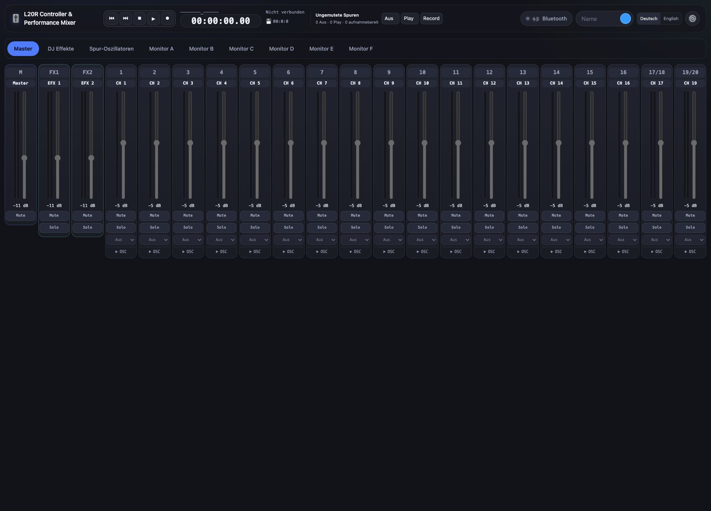
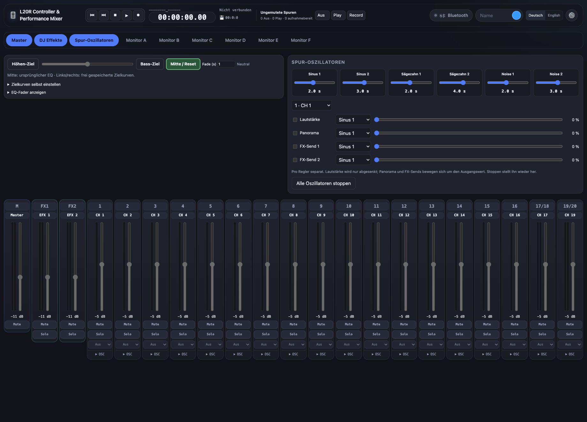
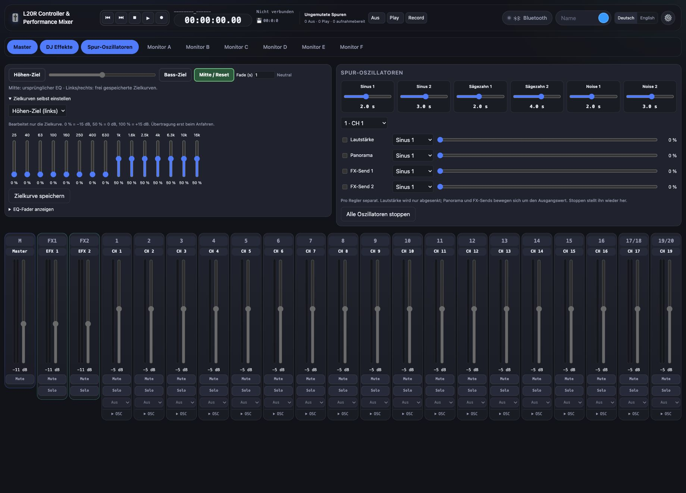
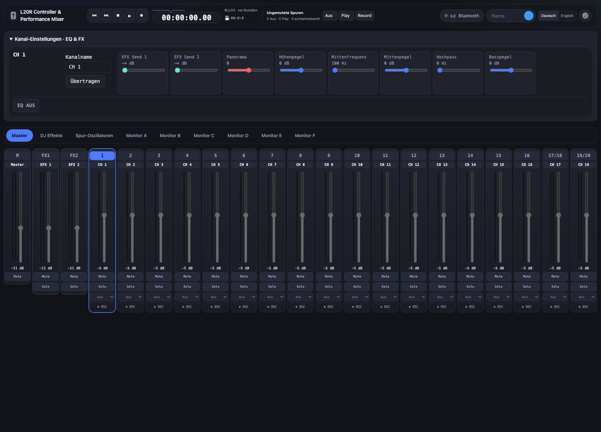
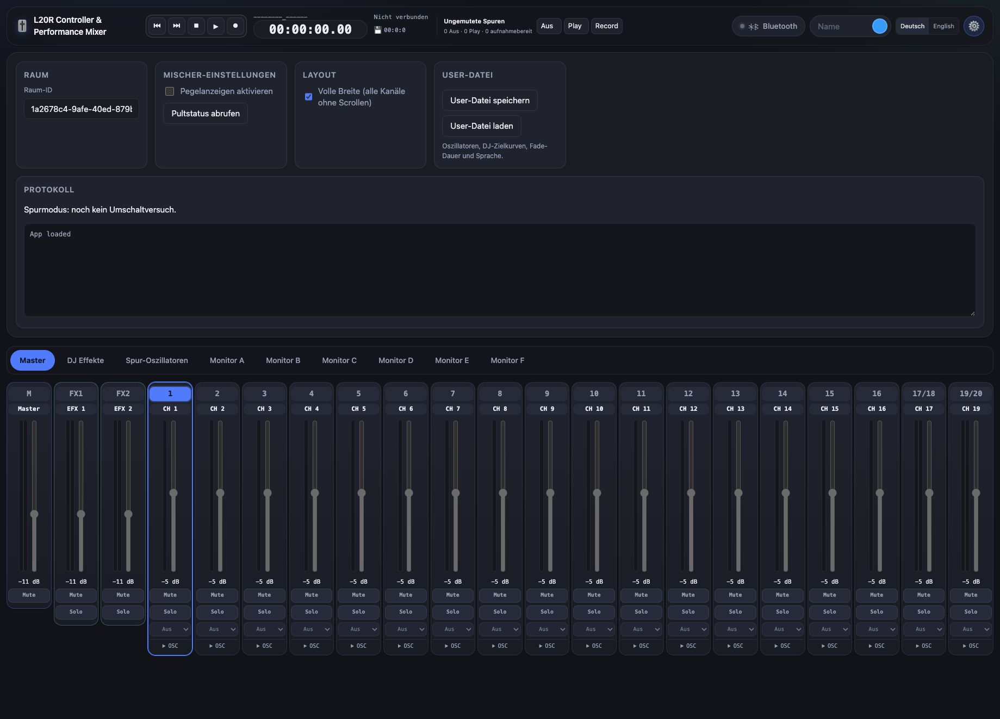

# L20R Controller & Performance Mixer

A browser-based Bluetooth controller and performance mixer for the **Zoom LiveTrak L-20R**, with a German/English interface. No build step or cloud account is required for direct Bluetooth control.

**This project is vibe coded. It is experimental software, not an official Zoom product. Use entirely at your own risk.** It can change mixer levels, EQ, effects and recording/playback settings in real time. Test it with your own setup before using it in a live show or an important recording. There is no warranty that every function works on every firmware/browser combination.

## Origin and license

This is a modified and extended version of **[PimDoos/zoom-L20-control](https://github.com/PimDoos/zoom-L20-control)**. The original project provides the foundation for the web interface, Bluetooth MIDI communication and mixer controls. Thank you to the original author and contributors.

The project retains the **Apache License 2.0**. See [LICENSE](LICENSE). This version adds the performance workflow and UI changes described below and in [AENDERUNGEN.md](AENDERUNGEN.md). It is not affiliated with, endorsed by, or supported by Zoom Corporation.

## Contributors / Mitwirkende

- **[Grischa Windus](https://github.com/grischa2211)** — project direction, feature ideas and hands-on testing with the L-20R / Projektleitung, Funktionsideen und praktische Tests am L-20R.
- **OpenAI Codex (AI coding assistant / KI-Programmierassistent)** — assisted with implementation, debugging, UI changes and documentation in collaboration with Grischa / Unterstützung bei Implementierung, Fehlersuche, Oberfläche und Dokumentation in Zusammenarbeit mit Grischa.
- **[PimDoos and upstream contributors](https://github.com/PimDoos/zoom-L20-control)** — original application and protocol foundation / ursprüngliche Anwendung und Protokollgrundlage.

Codex is credited here as an AI tool used in development. This does not imply official OpenAI participation, endorsement or support. / Codex wird hier als bei der Entwicklung eingesetztes KI-Werkzeug genannt. Daraus folgt keine offizielle Beteiligung, Empfehlung oder Unterstützung durch OpenAI.

## Screenshots & tutorial / Screenshots und Anleitung

**[Open the app / App öffnen](https://grischa2211.github.io/L20R-Controller-Performance-Mixer/)**

Die Screenshots zeigen die veröffentlichte App **ohne Bluetooth-Verbindung**. Deshalb sind Gerätefunktionen deaktiviert und Standard-Kanalnamen sichtbar. Nach dem Verbinden erscheinen die Daten des eigenen Pults.

The screenshots show the published app **without a Bluetooth connection**. Device controls are therefore disabled and default channel names are visible. Connecting loads your mixer's actual state.

### 1. Mixer und Transport / Mixer and transport

**Deutsch**

1. Öffne die App in einem Browser mit Web Bluetooth, klicke auf **Bluetooth** und wähle das L-20R. Warte, bis der Pultstatus eingelesen ist. Eine andere App muss ihre Bluetooth-Verbindung gegebenenfalls zuerst freigeben.
2. Wähle **Master** oder einen Monitor-Mix **A–F** und stelle die Kanal-Fader ein. Mute und Solo befinden sich direkt im Kanalzug.
3. Stoppe den Recorder, bevor du oben die ungemuteten Spuren gemeinsam auf **Aus / Play / Record** stellst. Gemutete Spuren bleiben unverändert. **Record macht die Spuren aufnahmebereit; es startet keine Aufnahme.**
4. Starte vorhandene Aufnahmen mit Play. Die Zeitanzeige wird bei Wiedergabe grün und bei Aufnahme rot. Ihre Hundertstel sind eine Schätzung zwischen den Positionsmeldungen des Pults.
5. Halte Rücklauf oder Vorlauf zum Spulen gedrückt und lasse zum Beenden los. Ein kurzer Klick führt den jeweiligen Sprung aus.

**English**

1. Open the app in a Web Bluetooth browser, click **Bluetooth**, select the L-20R and wait for its state to load. Another app may need to release its Bluetooth connection first.
2. Select **Master** or a monitor mix **A–F**, then adjust channel faders, mute and solo.
3. Stop the recorder before choosing **Off / Play / Record** for all unmuted tracks. Muted tracks remain unchanged. **Record arms tracks; it does not start recording.**
4. Play an existing recording. The position background turns green for playback and red for recording. Hundredths are estimated between mixer position reports.
5. Hold rewind/fast-forward to seek; release to stop seeking. A short click performs the corresponding jump.

### 2. Track-Oszillatoren / Track oscillators

**Deutsch**

1. Öffne **Track-Oszillatoren**. Es gibt je zwei Sinus-, Sägezahn- und weich verlaufende Rauschquellen. Der Geschwindigkeits-Slider bestimmt die Sekunden pro Zyklus: kleinere Werte sind schneller.
2. Wähle den Kanal im Block oder klicke unten auf seinen Kanalzug. Ordne Lautstärke, Panorama, FX 1 oder FX 2 eine Quelle zu, stelle die Stärke ein und aktiviere die gewünschte Route.
3. Beispiel: Wähle für die Lautstärke von Kanal 1 einen Sinus, **2 Sekunden** und **25 %** Stärke. Die Lautstärke bewegt sich unterhalb ihres Ausgangswerts. Bei **0 %** ist keine Bewegung hörbar.
4. Verwende dieselbe Quelle auf mehreren Spuren für synchrone Bewegungen; die Stärke bleibt pro Route getrennt einstellbar. Panorama und FX-Sends bewegen sich um ihren jeweiligen Ausgangswert innerhalb der verfügbaren Grenzen.
5. Unter jedem Eingangskanal bietet **OSC** dieselben vier Zuordnungen kompakt an: **S1/S2** = Sinus, **Z1/Z2** = Sägezahn, **N1/N2** = Rauschen. Stoppen stellt den Ausgangswert wieder her; ein manuell bewegter Fader beendet seine Route. **Alle stoppen** beendet sämtliche Routen.

Die Oszillatoren laufen im Browser. Bluetooth und Hintergrund-Tab-Drosselung begrenzen die zeitliche Genauigkeit.

**English**

1. Open **Track oscillators**. Choose from two sine, two sawtooth and two smooth-noise sources. Speed is measured in seconds per cycle: smaller values run faster.
2. Select a track in the block or click its channel strip. Assign a source to volume, pan, FX 1 or FX 2, set its strength and enable the route.
3. Example: use a sine source at **2 seconds**, **25%** strength for channel 1 volume. Volume moves below its starting level. **0%** produces no audible modulation.
4. Reuse a source to synchronize several routes while keeping their strengths independent. Pan and FX sends move around their starting values within the available range.
5. Expand **OSC** below an input strip for the same four routes. **S1/S2** means sine, **Z1/Z2** sawtooth and **N1/N2** noise. Stopping restores the starting value; moving a fader manually ends its route. **Stop All** ends every route.

Oscillators run in the browser. Bluetooth and background-tab throttling limit timing precision.

### 3. DJ-Zielkurven und Fades / DJ target curves and fades

**Deutsch**

1. Öffne **DJ Effects** und die Zielkurven-Einstellungen. Bearbeite die 15 EQ-Bänder für das Höhen- und Bass-Ziel nach Geschmack. Das Bearbeiten allein verändert den Klang noch nicht.
2. Die Skala entspricht ungefähr **0 % = −15 dB**, **50 % = 0 dB**, **100 % = +15 dB**. Speichere die gewünschte Zielkurve mit dem zugehörigen Speichern-Button.
3. Bewege den DJ-Slider nach links zum Höhen-Ziel oder nach rechts zum Bass-Ziel. Alternativ fährt ein Klick auf den Ziel-Button die Kurve automatisch an. **Fade** bestimmt die Dauer, standardmäßig eine Sekunde.
4. **Center/Reset** fährt zur ursprünglichen EQ-Kurve zurück und stellt deren ursprünglichen Ein/Aus-Zustand wieder her. Deine vorherige Kurve dient als Ausgangspunkt für die Performance.

Die Funktion verwendet den grafischen Hardware-EQ mit begrenzter Absenkung. Sie bildet keinen steilen Low-/High-Cut und keinen vollständigen Frequenz-Kill nach.

**English**

1. Open **DJ Effects** and expand target-curve settings. Edit the 15 EQ bands for the treble and bass targets. Editing alone does not change the sound.
2. The scale is approximately **0% = −15 dB**, **50% = 0 dB**, **100% = +15 dB**. Save each curve using its corresponding save button.
3. Move the DJ slider left toward the treble target or right toward the bass target. Clicking a target button fades there automatically. **Fade** sets the duration; the default is one second.
4. **Center/Reset** returns to the original EQ curve and its original enabled state. Your previous curve is the performance's starting point.

This uses the hardware graphic EQ's limited attenuation. It is not a steep high-/low-pass filter or a complete frequency kill.

### 4. Kanäle, Namen und EQ / Channels, names and EQ

**Deutsch**

1. Klicke auf einen Kanal, um dessen EQ- und FX-Einstellungen oben einzublenden. Ein weiterer Klick schließt den Bereich wieder.
2. Trage im Namensfeld bis zu **acht ASCII-Zeichen** ein und sende den Namen ans Pult. Die Rückmeldung zeigt, ob das Gerät den Namen übernommen hat.
3. Stelle EQ, Panorama und Effekt-Sends für den ausgewählten Kanal ein. Der gewählte Kanal wird auch im Track-Oszillator-Block ausgewählt.

**English**

1. Click a channel to open its EQ/FX controls above the strips. Click it again to collapse them.
2. Enter up to **eight ASCII characters** in the name field and send the name to the mixer. Device feedback indicates whether the name was accepted.
3. Adjust the selected channel's EQ, pan and effect sends. Selecting a channel also selects it in the track oscillator block.

### 5. User-Dateien speichern und laden / Saving and loading user files

**Deutsch**

1. Öffne **⚙️ Einstellungen → User-Datei**. Mit **Speichern** lädst du eine JSON-Datei herunter. Bewahre sie als benanntes Performance-Preset auf.
2. Gespeichert werden Oszillator-Geschwindigkeiten, Quellen, Stärken und Ein/Aus-Zustände pro Route sowie DJ-Zielkurven, Fade-Dauer und Sprache.
3. Mit **Laden** wählst du eine zuvor gespeicherte Datei. Aktiv gespeicherte Routen starten bei bestehender Verbindung wieder. Ohne Verbindung warten sie, bis das Pult verbunden und sein Status eingelesen ist. Prüfe deshalb vor dem Laden die Ausgangslautstärke.
4. **DE / EN** oben wechselt die Sprache. Gespeicherte DJ-Kurven und einige Ansichtsoptionen liegen zusätzlich lokal im Browser. Für übertragbare Oszillator-Presets verwende die User-Datei.

Eine User-Datei enthält keine Audiodaten und ist kein vollständiges Backup des Pults oder seiner Projekte.

**English**

1. Open **⚙️ Settings → User file**. **Save** downloads a JSON file that you can keep as a named performance preset.
2. It contains oscillator speeds, source assignments, strengths and enabled states for each route, plus DJ target curves, fade duration and language.
3. **Load** restores a saved file. Previously enabled routes resume when connected. If loaded offline, they wait for connection and the initial mixer-state read. Check output levels before loading.
4. **DE / EN** in the header switches language. Saved DJ curves and some view preferences also stay in this browser. Use a user file to transfer oscillator presets.

A user file contains no audio and is not a complete mixer or project backup.

## Features

### Mixer and channel controls

- Direct Bluetooth MIDI connection to the L-20R using a compatible Zoom Bluetooth adapter, such as the BTA-1.
- Master and monitor mix tabs A–F.
- Full-width layout to view the channel strips together.
- Longer, side-by-side level meters and volume faders.
- Channel mute, solo, recording/playback selection, panning, phase and channel EQ controls where supported by the protocol.
- Per-channel FX 1 and FX 2 sends and effect-return controls.
- Channel selection highlights the matching strip across the mix views.
- Clicking a channel opens its EQ/FX settings; clicking it again closes them.
- Channel names can be edited and sent to the mixer: up to eight ASCII characters.
- Level display uses playback/post-fader data for channels set to Play and input data otherwise.
- Bluetooth messages are serialized; pending continuous-control values are coalesced to reduce backlog.

### Recorder and track modes

- Play/pause and Stop transport controls.
- Rewind and fast-forward: click for a marker/end-point jump, hold to seek, release to stop seeking.
- Current project name, position and remaining recording time display.
- Smooth **estimated hundredths** between whole-second position reports. This is a visual estimate, not frame-accurate timecode.
- Rounded time display with a green background during playback and red during recording, plus explicit status text.
- Shared **Off / Play / Record** selection for unmuted input tracks. Record here means track arming, not starting recording.
- Track mode changes require the recorder to be stopped. The app reads the mixer state and cycles REC/PLAY as necessary.
- Stereo-master playback is cleared before switching individual tracks, because the mixer excludes their playback while the stereo-master track is selected.
- Muted channels are excluded from group mode changes. No channel number is hard-coded as defective or excluded.
- A dedicated track-mode diagnostic appears in Settings above the log.

### DJ EQ performance

- Independently expandable DJ Effects block next to the track oscillator block.
- Centered DJ slider that blends the saved original main EQ toward a treble or bass target.
- Click a target button to fade there automatically; configurable fade duration, default **one second**.
- Active target buttons are highlighted in different colors.
- Fully editable target curves for all 15 graphic-EQ bands, including boosts.
- Target editing does not send changes until the target is approached.
- Center/Reset returns the EQ to its original curve and original enable state.
- Default targets emphasize frequencies above roughly 800 Hz or below roughly 400 Hz; custom curves replace those defaults.
- Target curves can be saved in the browser and in a user file.
- Main-EQ faders can be expanded to see the moving curve.

**Important:** DJ filters are approximated using the hardware's graphic EQ. Each band is limited to its available gain range (approximately −15 to +15 dB). This is not a dedicated steep high-pass/low-pass filter or a complete frequency kill.

### Track oscillators / LFOs

- Six shared sources: **two sine, two sawtooth, two smoothly varying noise** oscillators.
- Speed slider for each source: **0.2–30 seconds per cycle**, with logarithmic adjustment and a numeric readout.
- Four independently routed destinations per input track: **volume, panning, FX Send 1, FX Send 2**.
- Independent source choice, strength (0–100%) and enabled state for every route.
- New routes default to **0% strength**.
- The same source can modulate multiple destinations in sync; each destination retains its own strength.
- Volume modulation reduces the starting level; panning and FX sends move around their starting values within the control's range.
- Stopping a route restores its starting value. Manually moving its fader ends that route.
- A global Stop All control is available inside the track oscillator block.
- Compact expandable **OSC** routing underneath each input channel strip.
- Source and strength selections remain synchronized between the channel strip and the main oscillator block.
- Clicking a channel also selects it in the oscillator track selector.

### User files and language

- German/English switch in the header; language preference is stored in the browser.
- Export/import a portable **JSON user file** with source speeds, per-track routing, strengths, enabled states, DJ target curves, fade duration and language.
- Saved enabled routes resume when loaded with a Bluetooth connection. If loaded offline, they wait until the mixer is connected and its state is read.
- Import validates the complete file before applying it. Older version-1 user files remain readable; they do not contain enabled states.
- The user file is a performance preset, **not** a full mixer/project/SD-card backup. It does not contain credentials or audio.

## Getting started

1. Download or clone this repository.
2. Use a Chrome/Chromium browser with Web Bluetooth support and a compatible Bluetooth adapter on the L-20R.
3. Open `index.html` locally, or use the HTTPS-hosted version if GitHub Pages has been enabled.
4. Disconnect other apps/devices that are holding the mixer Bluetooth connection.
5. Click **Bluetooth**, select the mixer and let the app read its state.
6. Use the master/monitor tabs for mixing. Stop transport before changing track modes.
7. Open **DJ Effects** or **Track oscillators** for the performance controls.
8. Use **Settings → User file** to download a JSON preset or restore one.

No package installation, bundler or server is needed for the direct Bluetooth workflow. A browser that does not implement Web Bluetooth cannot control the mixer directly.

## What is stored where?

- Saved DJ target curves, language and selected layout preferences use browser `localStorage`.
- Oscillator configuration and active modulation live in the current session unless exported to a user JSON file.
- Exported user files are ordinary downloads that you can keep, rename and transfer yourself.
- Mixer settings are sent to the actual device; browser presets are not a replacement for the device's own project backup.

## Limitations and validation

This version was developed against an L-20R workflow. Several functions were checked interactively on the user's mixer; others have software-level checks only. It has not had comprehensive automated hardware testing.

- Bluetooth latency and throughput limit timing precision, especially with many simultaneous modulations.
- LFOs run in the browser and are not sample-accurate or tempo/timecode-synchronized. Background-tab throttling may affect them.
- Meter resolution is limited by the values supplied by the mixer.
- Transport and REC/PLAY behavior depend on recorder state, available recordings and firmware.
- The recorder Record transport button has not been fully hardware-validated in this version.
- An arbitrary project/file browser is not implemented.
- WebSocket/network client code inherited from the original remains in the source, but its UI is hidden. This repository does not include the original WebSocket server. Direct Bluetooth is the supported workflow here.
- User presets containing enabled routes can immediately change levels/pan/effect sends after connection. Check the preset and output level before loading it.

## Files

- `index.html`, `style.css`: page and layout.
- `app.js`: connection, track workflows and application state.
- `controls.js`: mixer UI, controller definitions, recorder and DJ EQ.
- `midi.js`: Bluetooth MIDI encoding/decoding and send queue.
- `performance.js`: shared LFO sources and channel routing.
- `user-settings.js`: validated JSON preset import/export.
- `i18n.js`: German/English UI translations.

---

## Deutsch

**Experimenteller, vibe-gecodeter Browser-Controller für das Zoom LiveTrak L-20R. Nutzung ausschließlich auf eigenes Risiko, ohne Gewährleistung. Kein offizielles Zoom-Produkt.**

Basis ist **[PimDoos/zoom-L20-control](https://github.com/PimDoos/zoom-L20-control)** unter Apache-2.0; die ursprüngliche Lizenz bleibt erhalten.

Die App ergänzt den Mixer um eine kompakte Transportanzeige, Kanalnamen, gemeinsame Spurmodi, frei einstellbare DJ-EQ-Zielkurven, automatische Fades und sechs gemeinsame Oszillatoren. Pro Spur lassen sich Lautstärke, Panorama und beide FX-Sends einzeln zuordnen und dosieren. Einstellungen einschließlich Ein/Aus-Zuständen können als User-JSON gespeichert und geladen werden. Oben lässt sich die Bedienoberfläche auf Deutsch oder Englisch umstellen.

`index.html` in einem Browser mit Web Bluetooth öffnen, Bluetooth verbinden und den Pultstatus einlesen lassen. Vor dem Wechsel zwischen Aus/Play/Record den Recorder stoppen. Unter Einstellungen lassen sich User-Dateien speichern und laden.

Hundertstel der Zeitanzeige sind geschätzt. DJ-Filter sind eine Annäherung mit dem grafischen EQ, kein vollständiger Frequenz-Kill. Oszillatoren laufen im Browser und sind nicht samplegenau. Bitte alle benötigten Funktionen vor einem Live-Einsatz mit dem eigenen Pult und der eigenen Firmware prüfen.
